# Awesome-Edtech-Knowledge-Extraction-From-Books


  





  
  
  
  
  



# 📚 Top EdTech & Knowledge Extraction From Books

**Curated List of SaaS Products & Open-Source GitHub Projects**  
*Focused on Book-to-Skill Pipelines, Textbook Parsing, Structured Knowledge Graphs, Active-Recall Generation & Interactive Learning Platforms*  
**Last updated: November 2026**

This repository tracks notable **SaaS platforms** and **open-source projects** for **EdTech & Knowledge Extraction From Books**. These tools transform long-form books, textbooks, EPUBs, and PDFs into structured skill trees, interactive micro-lessons, spaced-repetition flashcards, mind maps, audio overviews, and executable knowledge bases for learners, educators, and AI researchers.

**Examples** include Duolingo, Coursera, edX (2U), MasterClass, Pluralsight, Udacity (Accenture), Brilliant, Skillshare, Codecademy (Skillsoft), and Khan Academy (the category leaders).

**🚀 Open-source emphasis**: This section is heavily expanded with every major active project for book-to-skill extraction, deep PDF/EPUB document parsing, knowledge graph construction, automated flashcard/quiz generation, and self-hosted AI study notebooks — ideal for lifelong learners, EdTech engineers, and researchers building structured curricula from books without proprietary lock-in.

🤝 Contributions welcome! Open a PR to add/update entries. Keep descriptions factual and link to official sites.

## 📑 Table of Contents
- [📊 Sector Overview & Market Dynamics](#-sector-overview--market-dynamics)
- [☁️ SaaS/Hosted Platforms](#️-saashosted-platforms)
- [💻 Open-Source GitHub Projects](#-open-source-github-projects)
- [🛠️ How to Contribute](#️-how-to-contribute)
- [⚠️ Disclaimer](#️-disclaimer)
- [💖 Support & Thank You](#-support--thank-you)

## 📊 Sector Overview & Market Dynamics

The global EdTech and structured digital learning market is valued at approximately **$213B–$215B in 2026**, while the **AI-driven Content Authoring, Knowledge Extraction & Personalized Learning** segment accounts for roughly **$9.6B–$11.4B in 2026** (growing at ~26%–35% CAGR). The landscape is **moderately fragmented** across technical skills, academic textbooks, and micro-learning formats, though consumer subscription learning exhibits **winner-take-most concentration** around scaled platforms like Duolingo, Coursera, and MasterClass—creating strong demand for open-source book-to-knowledge pipelines that unlock personal libraries.

## ☁️ SaaS/Hosted Platforms

*Sorted descending by company valuation / annual revenue scale.*

| Platform | Description | Company Scale (Valuation / Revenue) | Starting Paid Tier | Free Tier / Trial Limit |
| :--- | :--- | :--- | :--- | :--- |
| **[Duolingo](https://duolingo.com)** | Interactive bite-sized skill-tree learning platform transforming structured curricula into gamified micro-lessons with AI explanations. | **$5.70B Valuation** ($1.04B FY2025 revenue) | **$12.99/mo** (or ~$84–$96/yr for Super Duolingo; Lite at $35.99/yr) | **Forever Free** (Full skill-tree access with daily Energy limits and ads; 7–14 day Super free trial) |
| **[Coursera](https://coursera.org)** | Online learning platform distilling university textbooks and curricula into modular video courses, guided projects, and AI study coaches. | **$1.23B FY2026 Est. Revenue** (~$590M market cap; $880M TTM revenue) | **$49/course** one-time (or **$59/mo** / **$399/yr** for Coursera Plus) | **Forever Free Audit** (Video lectures & readings on most courses; excludes graded quizzes/certificates; 7-day Plus trial) |
| **[MasterClass](https://masterclass.com)** | Structured video learning platform distilling expert books, frameworks, and methodologies into episodic lessons and downloadable workbooks. | **~$1.20B–$2.75B Peak Valuation** (~$150M+ est. annual revenue) | **$10/mo** billed annually ($120/yr Standard plan for 1 device) | **30-Day Money-Back Guarantee** (Select free sample trailers/lessons; no perpetual free tier) |
| **[Pluralsight](https://pluralsight.com)** | Technology skill development platform mapping technical literature into structured skill assessments, learning paths, and hands-on labs. | **~$1.00B+ Enterprise Scale** (Acquired by Vista Equity for $3.5B; ~$500M+ ARR) | **$29/mo** (or **$299/yr** for Core Tech individual plan) | **10-Day Free Trial** (Limited to 200 minutes of course viewing and skill IQ assessments) |
| **[edX (2U)](https://edx.org)** | Global MOOC and executive education platform converting academic textbooks and university syllabi into interactive self-paced programs. | **~$750M–$800M Annual Revenue** (Part of 2U restructuring) | **$50–$299/course** for verified track (or **$349/yr** edX Enterprise/subscription tiers) | **Forever Free Audit** (Full access to course readings and lectures for a limited audit window without graded exams/certificates) |
| **[Udacity (Accenture)](https://udacity.com)** | Technical upskilling platform translating industry engineering books and frameworks into project-based Nanodegree programs with AI feedback. | **~$500M–$1B Acquisition Scale** (Acquired by Accenture; ~$100M+ historical ARR) | **$249/mo** (or **$846 for 4-month** bundled Nanodegree access) | **7-Day Free Trial** (Full catalog preview on monthly subscription before billing begins) |
| **[Brilliant](https://brilliant.org)** | Interactive STEM learning platform distilling math, data science, and CS textbooks into visual, problem-first active-learning modules. | **~$350M–$500M Est. Valuation** (~$50M+ est. ARR) | **$24.99/mo** (or **$13.49/mo** billed annually at $161.88/yr) | **Forever Free Preview** (Daily free interactive puzzles and first lessons of every STEM course; 7-day Premium trial) |
| **[Skillshare](https://skillshare.com)** | Creative and entrepreneurial learning community turning practitioner playbooks into project-driven classes and structured learning paths. | **~$300M–$400M Est. Valuation** (~$75M+ est. ARR) | **$13.99/mo** billed annually ($167.88/yr membership) | **7-Day Free Trial** (Full unlimited access to all classes and project workshops; select free starter classes) |
| **[Codecademy (Skillsoft)](https://codecademy.com)** | Interactive coding platform converting programming reference books into browser-based step-by-step exercises, quizzes, and AI code reviews. | **~$200M+ Segment Revenue** (Acquired by Skillsoft for ~$525M) | **$17.49/mo** billed annually ($209.88/yr Plus) or **$29.99/mo** Pro annual | **Forever Free Basic Plan** (Access to introductory coding chapters and basic syntax lessons; 7-day Pro/Plus trial) |
| **[Khan Academy](https://khanacademy.org)** | Non-profit mastery learning platform breaking down K–14 textbooks into granular knowledge maps, practice exercises, and Khanmigo AI guidance. | **$117.5M Annual Revenue** (FY2024–2025 501(c)(3) nonprofit filings) | **$4/mo** (or **$44/yr** for Khanmigo learner plan; $0 for core platform) | **Forever Free** (100% of mastery trees, videos, and practice exercises free forever without ads) |

## 💻 Open-Source GitHub Projects

| Project | License / Hosting Cost | Free Tier / Self-Hosted Limit | Description |
| :--- | :--- | :--- | :--- |
| **[Book-to-Skill (`virgiliojr94/book-to-skill`)](https://github.com)** | **Open-Source** ($0 software license; BYO LLM API keys or local models) | **100% Free forever** (Unlimited books processed into structured skills on your own machine/keys) | Open-source pipeline designed to extract actionable skills, structured lessons, and learning roadmaps directly from books and long-form texts. |
| **[Docling (`DS4SD/docling`)](https://github.com)** | **MIT Open-Source** ($0 local Python library & CLI) | **100% Free forever** (Unlimited PDF, DOCX, EPUB, table, and formula extractions on local CPU/GPU) | IBM's advanced open-source document parser converting complex PDF textbooks, equations, and layouts into clean Markdown and JSON for knowledge extraction. |
| **[Marker (`VikParuchuri/marker`)](https://github.com)** | **GPL-3.0 Open-Source** ($0 local deep-learning pipeline) | **100% Free forever** (Unlimited high-speed PDF book-to-Markdown/JSON conversions on local GPU/CPU) | High-accuracy deep-learning pipeline that rapidly converts PDF books, tables, LaTeX equations, and code blocks into structured Markdown or HTML. |
| **[MinerU (`opendatalab/MinerU`)](https://github.com)** | **AGPL-3.0 Open-Source** ($0 local extraction toolkit) | **100% Free forever** (Unlimited multi-column scientific/textbook PDF parsing into structured Markdown and JSON) | High-precision open-source PDF knowledge extraction tool engineered to strip headers/footers and preserve reading order, formulas, and tables in textbooks. |
